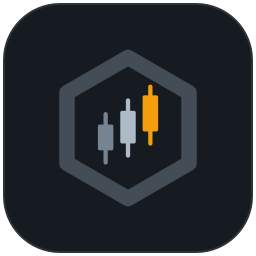
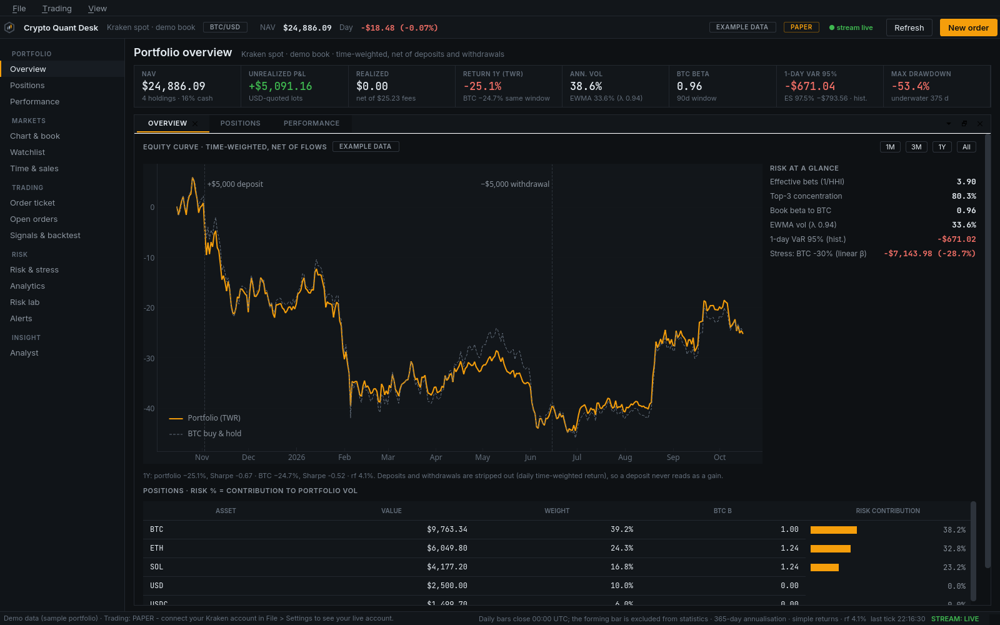
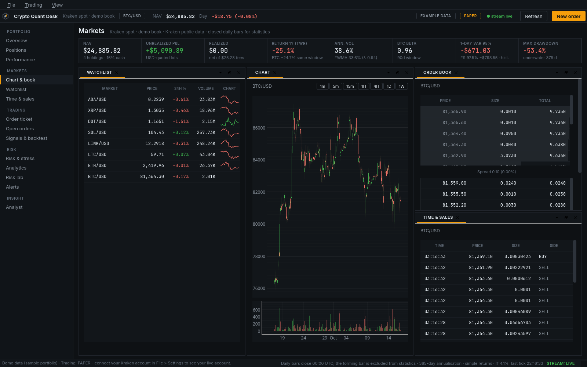
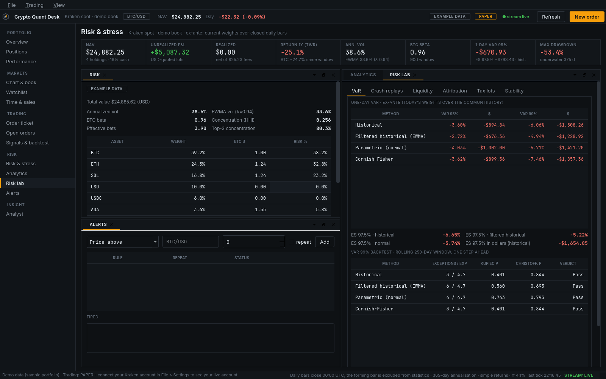
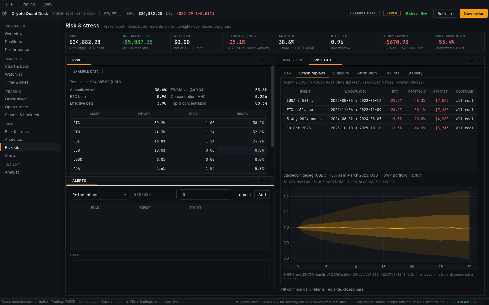
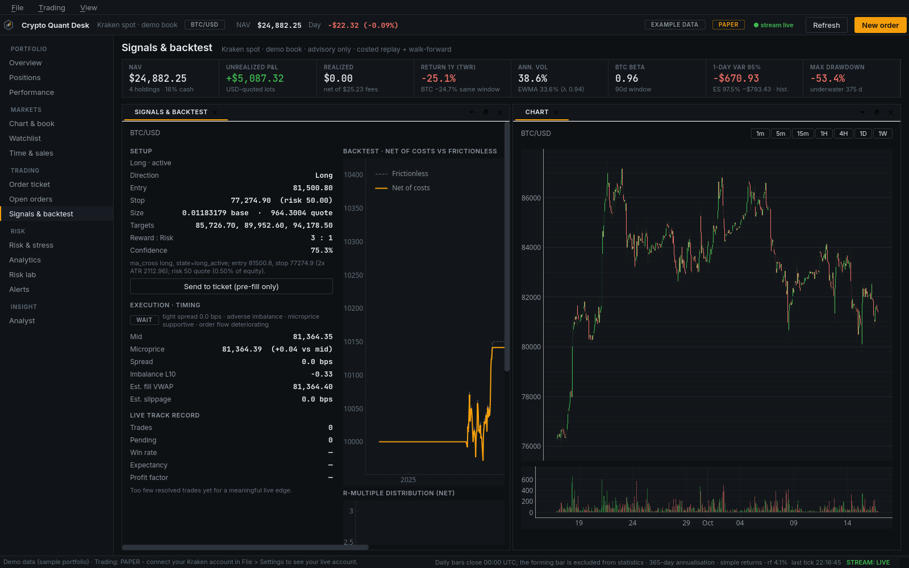
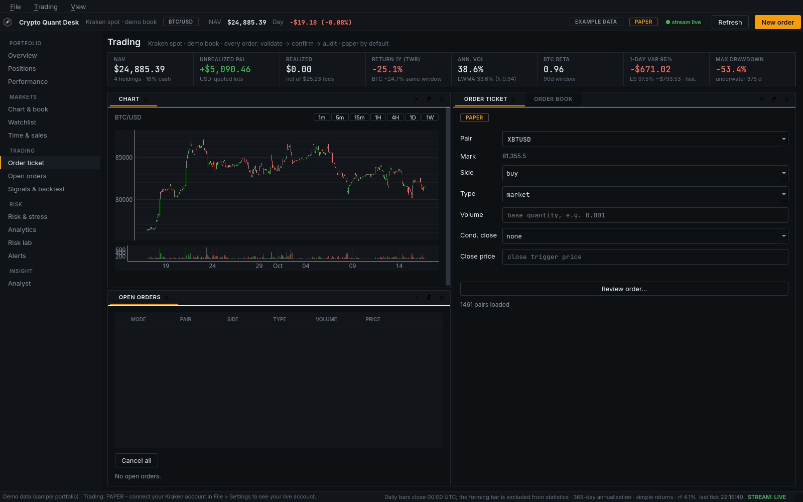

<p align="center">
  
</p>

<h1 align="center">Crypto Quant Desk</h1>

<p align="center">
  A Kraken spot trading terminal with desk-grade risk analytics, for Windows and macOS.
</p>



Kraken's dashboard shows balances and orders. Crypto Quant Desk adds what a risk
desk would want on top: time-weighted performance with deposits removed,
fee-inclusive cost basis, VaR that is backtested rather than assumed, crash
replays of the book you hold today, liquidity, attribution against BTC and tax
lots. It is also a full order terminal with hard safety rails.

Every number comes from a pure, tested engine fed only by Kraken's official
APIs. The UI displays the numbers and the optional AI analyst narrates them;
neither one computes a figure. There is no telemetry and no third-party data,
and your keys stay in your OS keychain.

## Pages

| Page | What's on it |
|---|---|
| **Portfolio** | TWR equity curve vs BTC buy-and-hold (flows stripped out), positions with fee-inclusive cost basis and break-even, performance and trade stats |
| **Markets** | Watchlist with sparklines, candlestick chart with volume, live depth ladder, time and sales |
| **Trading** | Every Kraken spot order type with attached TP/SL, open orders (cancel/edit), paper mode by default |
| **Signals** | Sized trend setup, an order-book timing verdict (GO / WAIT / CAUTION), a costed backtest next to its frictionless twin, a net-of-fee live track record |
| **Risk** | Risk card (vol, EWMA vol, beta, concentration, risk contribution), analytics suite and the **Risk lab** |
| **Insight** | Rules-based narrative of the computed numbers; optional AI analyst with your own key |

A KPI strip (NAV, unrealized P&L, realized, 1Y TWR, vol, BTC beta, one-day VaR
with ES 97.5%, max drawdown) stays on screen on every page. You can float, tab,
split and resize every panel, and the app saves each page's layout.



### Risk lab



- **VaR set**: historical, filtered historical (EWMA λ 0.94), parametric and
  Cornish-Fisher at 95% and 99%, plus ES 97.5%. Each method is backtested over a
  rolling 250-day window with Kupiec and Christoffersen tests.
- **Crash replays**: today's book through LUNA (2022), FTX (2022), the Aug 2024
  carry unwind and the 10 Oct 2025 cascade, using real per-asset moves from
  Kraken's trade history. Also a stablecoin depeg shock and a 30-day bootstrap
  NAV fan.
- **Liquidity**: days to exit at 10% of 30-day volume, downside beta and rolling
  correlation.
- **Attribution**: active return vs BTC split exactly into allocation, beta and
  selection; deepest drawdowns; fee drag.
- **Tax lots**: FIFO, HIFO and average cost side by side.
- **Stability**: a walk-forward expectancy heatmap over the strategy's
  parameter grid.



### Signals and trading



The signal engine is advisory. **Send to ticket** fills in price and size and
does nothing else, and no code path leads from a signal to an order.
Backtests fill at the next open plus slippage, include fees, handle gaps
through stops, and pick parameters with an anchored walk-forward.



## Safety model

- **Paper mode is the default.** Going live requires typing `LIVE`.
- **Every order** passes validation, a confirmation dialog with estimated cost
  and fee, and a max-order-value cap (default $500, both modes, fails closed
  without a price).
- **The cap and mode are re-checked at send time.** A change after the confirm
  dialog refuses the order; it never resizes it.
- **Every order attempt** is appended to a local JSONL audit log, kept outside
  the repo, with no key material.
- **Keys** live in Windows Credential Manager or the macOS Keychain. They need
  only query and trade permissions. **Never enable Withdraw Funds.** The app has
  no withdrawal code path.

These rails are pinned by tests.

## Install

- **Windows**: per-user installer built from [`packaging/windows/`](packaging/windows/)
  (no admin, Start-menu shortcut, uninstall keeps your data and keys).
- **macOS**: `.app` / `.dmg` built from [`packaging/`](packaging/). It is
  unsigned, so on first launch right-click it and choose Open.

First launch opens in **demo mode**: a sample book with live Kraken market data.
To connect your account, go to **File > Settings** and enter a Kraken API key
from https://www.kraken.com/u/security/api with Query Funds, Query
Open/Closed Orders & Trades, Query Ledger Entries and Create & Modify Orders
(**never** Withdraw).

## Development

Requires Python 3.11+ (CI tests 3.12 and 3.13). Dependencies are locked in `uv.lock`; `requirements-lock.txt`
is the same lock for pip.

```bash
git clone https://github.com/ccharafeddine/crypto-quant-desk.git
cd crypto-quant-desk

uv sync --extra dev            # or: python -m venv .venv && pip install -r requirements-lock.txt -e .
uv run python -m cqd

uv run pytest -q               # 548 tests
uv run ruff check src tests
uv run ruff format src tests
```

CI runs lint, format and tests on Windows and macOS for Python 3.12 and 3.13
against the lock.

## Architecture

```
src/cqd/
├── engine/     pure math: risk, metrics, var, stress, attribution, tax_lots,
│               cost_basis, performance, backtest, signals, microstructure, scenario
├── data/       Kraken REST + WebSocket clients, demo client, normalisation,
│               returns, crash history, track record
├── trading/    order service (prepare → confirm → send), paper broker, limits, audit
├── alerts/     rule engine + native notifications
├── analyst/    rules narration + optional LLM, grounded in engine output
└── ui/         PySide6 shell, nav rail, KPI strip, QtAds dock panels, Graphite theme
```

The engine is pure functions with no I/O, Qt or network code, tested against
hand-computed vectors. The statistics drop Kraken's still-forming candle. There
is no database: the app uses settings files, JSON state and the OS credential
vault. The full spec is in [`docs/`](docs/).

Screenshots and the site kit are generated by
`scripts/capture_screenshots.py` and `scripts/build_site_kit.py`.

## License

MIT. See `LICENSE`.

## Disclaimer

This is experimental software. It can place real orders on your live Kraken
account if you turn on live mode with trade-permissioned keys. Use it at your
own risk. The authors accept no liability for financial losses. Tax-lot figures
are arithmetic, not tax advice.
